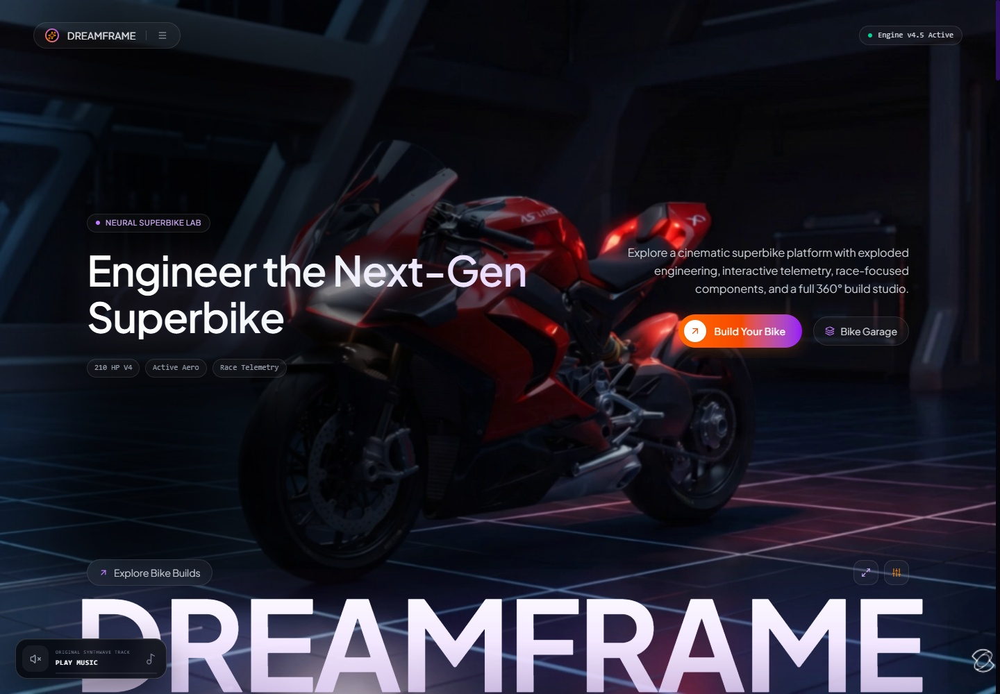
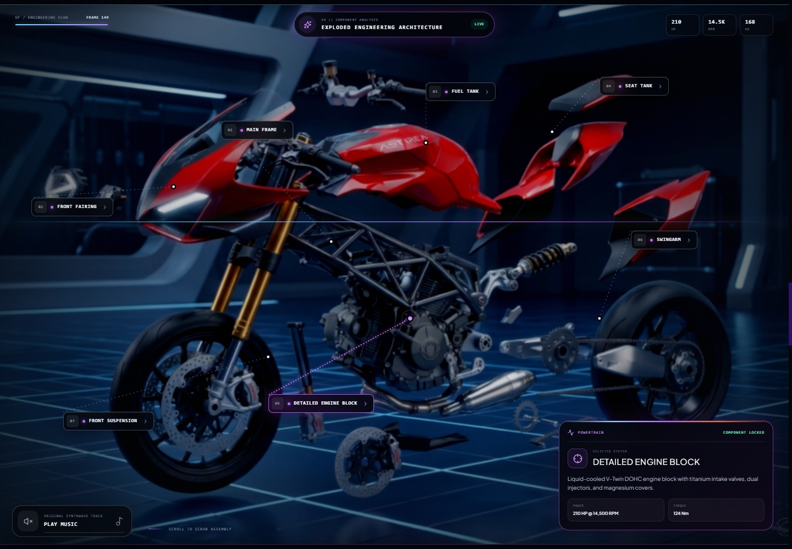
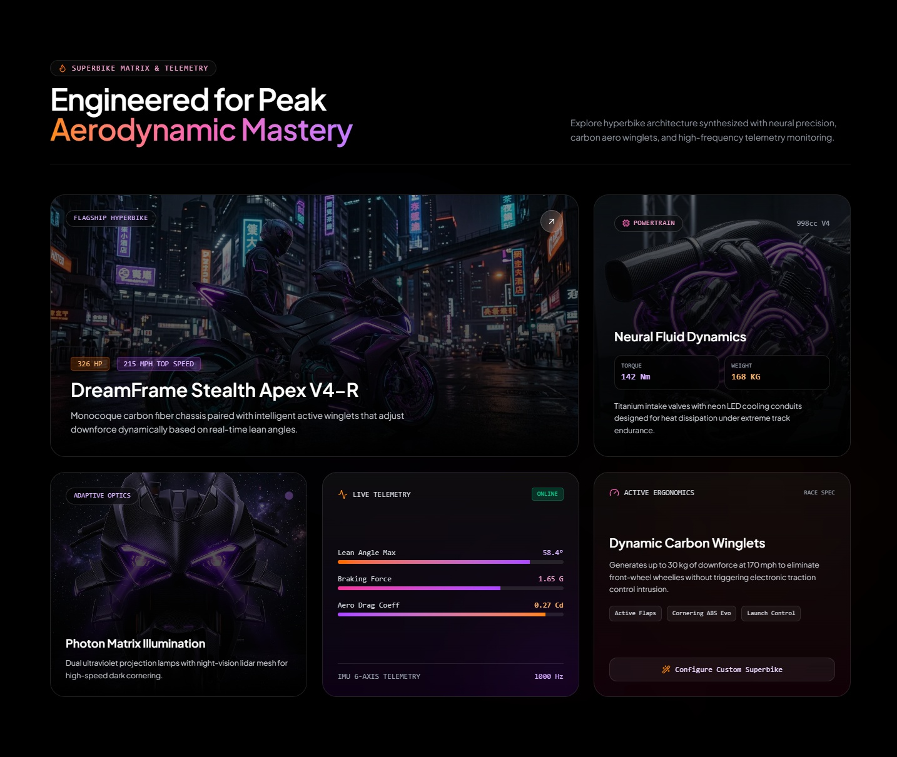
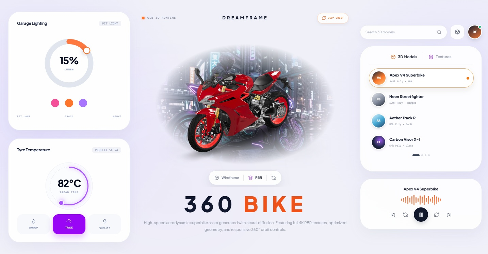
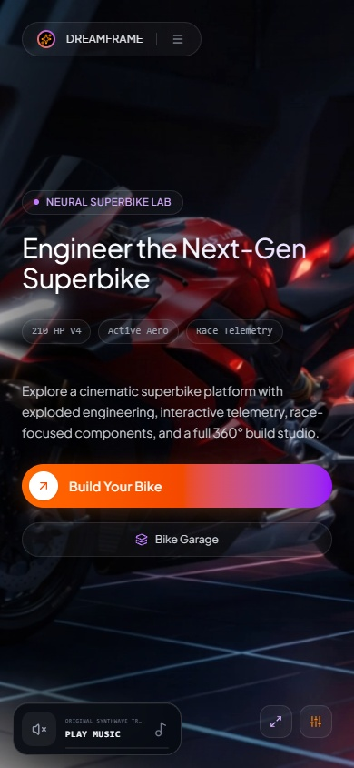

# DREAMFRAME

### Interactive Superbike Engineering

A cinematic superbike concept website built with Next.js, React, and TypeScript. Explore a scroll-driven exploded bike animation, inspect engineering details, and interact with a 3D garage in a dark interface with orange and violet accents.



## Website previews

### Exploded engineering view

The scroll-driven bike sequence with interactive component callouts.



### Bike Matrix

Engineering cards and concept specifications presented in a responsive grid.



### 360° Garage Studio

An interactive bike viewer alongside lighting, temperature, playback, and asset-library controls.



<details>
<summary>View the mobile homepage</summary>



</details>

These screenshots are captured from the running website after its fonts, images, and 3D model finish loading. Section previews show the complete section; floating sound controls are hidden in those captures to keep the cards visible. Images are stored in the repository so they display on GitHub.

## Features

- **Scroll-driven animation:** a 151-frame canvas sequence reveals an exploded engineering view with interactive component information.
- **3D bike viewer:** rotate and zoom the bundled GLB model using Google's `<model-viewer>`, with auto-rotation and render controls.
- **Garage controls:** adjustable ambience, tyre-temperature modes, playback controls, and searchable model and texture cards.
- **Build preview:** a prompt panel, style and model selectors, image previews, a garage gallery, and prompt copying.
- **Original soundscape:** an optional synthwave track generated in the browser with the Web Audio API.
- **Responsive design:** desktop and mobile layouts, scroll reveals, parallax effects, and a custom futuristic footer.

This is a frontend concept demo. The build generator simulates loading and selects a bundled image; it does not call an AI service. Specifications and telemetry are presentation data. Library cards do not represent separate downloadable models.

## Tech stack

| Technology | Purpose |
| --- | --- |
| Next.js 16.3.5 | App Router, development server, and production build |
| React 19.2.8 | Components and interactive state |
| TypeScript 5 | Type checking |
| Tailwind CSS 4 and CSS Modules | Layout, styling, and effects |
| Lucide React | Interface icons |
| Google model-viewer 3.4.0 | Browser-based GLB rendering |
| Canvas and Web Audio APIs | Frame animation and synthesized music |

## Getting started

### Requirements

- Node.js **20.9 or newer** and npm.
- A modern browser with WebGL support for the 3D viewer.
- Internet access for dependency installation, Google Fonts during builds, and the external model-viewer script at runtime.

### Install and run

After cloning or downloading this repository, open a terminal in its root directory:

```bash
npm ci
npm run dev
```

Open **[http://localhost:3000](http://localhost:3000)**. The page updates as you edit the source files. No environment variables or API keys are required by the current implementation.

### Available commands

| Command | Description |
| --- | --- |
| `npm run dev` | Start the development server |
| `npm run build` | Create a production build |
| `npm run start` | Serve an existing production build |
| `npm run lint` | Run ESLint |

For a local production preview:

```bash
npm run build
npm run start
```

## Project structure

```text
aniweb/
├── app/
│   ├── page.tsx                  # Homepage, engineering cards, and dialogs
│   ├── layout.tsx                # Fonts, metadata, and model-viewer script
│   └── globals.css               # Global styles and motion effects
├── components/
│   ├── ScrollCanvasAnimation.tsx # Frame sequence and component hotspots
│   ├── ScrollMotion.tsx          # Scroll reveals and parallax
│   ├── EnvironmentControls.tsx   # 3D garage and interactive controls
│   ├── BikeSoundscape.tsx        # Synthesized music and sound toggle
│   ├── FuturisticFooter.tsx      # Footer and section navigation
│   └── *.module.css             # Component styles
├── public/
│   ├── 3D-model/sports_bike.glb  # Model used by the garage viewer
│   ├── frames/                   # Bike animation frames
│   └── images/                   # Bike imagery and gallery assets
├── docs/
│   ├── screenshots/             # Website previews used in this README
│   └── capture-readme.cjs        # Local screenshot capture utility
├── types/model-viewer.d.ts       # Custom element TypeScript definitions
├── package.json
└── package-lock.json
```

## Customization

- Change homepage copy, concept specifications, gallery content, and the prompt panel in `app/page.tsx`.
- Update the site title, description, fonts, and model-viewer script in `app/layout.tsx`.
- Adjust garage presets, asset cards, and the 3D model path in `components/EnvironmentControls.tsx`.
- Update hotspots and frame sequencing in `components/ScrollCanvasAnimation.tsx`. The active sequence uses `public/frames/ezgif-frame-001.png` through `ezgif-frame-151.png`.
- Replace images in `public/images/` and update their references as needed.
- Customize the appearance through `app/globals.css` and the component CSS Modules.

### Refreshing screenshots

The included capture utility requires Node.js 22 or newer and a local Chrome DevTools connection. Start the website at `http://127.0.0.1:3000`, launch a separate headless Chrome instance with `--remote-debugging-port=9223` and a dedicated `--user-data-dir` and WebGL support (for software rendering, add `--enable-unsafe-swiftshader --use-angle=swiftshader`), then run from the repository root:

```bash
node docs/capture-readme.cjs
```

It waits for assets to load, then saves desktop homepage, exploded engineering, complete Bike Matrix and Garage Studio sections, and mobile homepage previews to `docs/screenshots/`. Close the dedicated browser instance when finished.

## Deployment

### Vercel

Import the GitHub repository into Vercel, select the Next.js framework preset, and use the repository root as the project directory. The build command is `npm run build`; use the framework's default output settings.

### Node.js hosting

On a host that supports Node.js, install dependencies with `npm ci`, run `npm run build`, and launch the app with `npm run start`. Keep the `public/` assets available alongside the production build.

GitHub hosts the repository and renders this README. Deploying to GitHub Pages requires a separate static-export setup; this project currently uses the standard Next.js server configuration.

## Preparing a GitHub upload

Commit the source files, `package-lock.json`, `docs/screenshots/`, and assets referenced by the website. The `.gitignore` excludes dependencies, build output, local environment files, and the screenshot browser profile.

The unused `public/back-frames.zip` archive is also ignored because it exceeds GitHub's 100 MB per-file limit. The extracted animation frames remain in `public/frames/`. The required `public/3D-model/sports_bike.glb` model is approximately 41 MB; consider repository size and initial viewer loading time when adding more assets.

Before publishing, run `npm run lint` and `npm run build`, review the files being committed, and check the distribution rights for the included images and 3D assets. No license file is currently included; add an appropriate license if you want to grant reuse rights.
